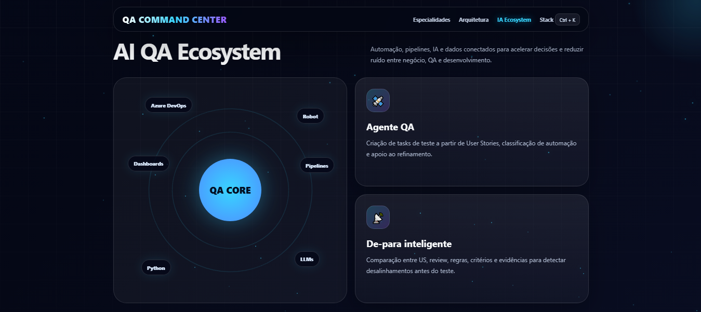

<h1 align="center">🚀 QA Command Center</h1>

  <strong>AI • Automation • DevOps • Quality Architecture</strong>

  Transformando qualidade em vantagem competitiva através de automação inteligente, processos sólidos e IA aplicada.

  

  <a href="https://dilei27.github.io/qa-command-center/" target="_blank">
    <strong>🔥 OPEN QA COMMAND CENTER 🔥</strong>
  </a>

---

## 🧠 About

QA Engineer com foco em automação, IA aplicada, DevOps e construção de bases sólidas para processos de qualidade.

## ⚙️ Stack

Python • Robot Framework • Sikuli • Playwright • Cypress • Docker • Azure DevOps • GitHub Actions • LLMs • RAG • Agentes IA

## 🌍 Portfolio

👉 https://dilei27.github.io/qa-command-center/
